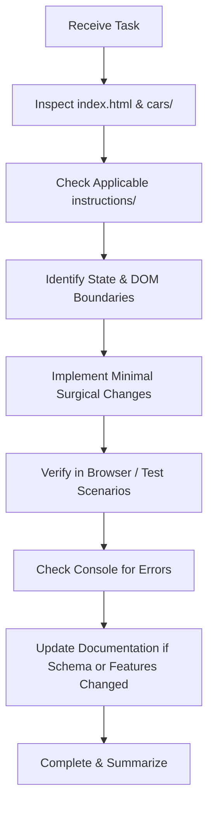

# AGENTS.md — AutoLog Engineering & AI Agent Operating Guide

> **Target Audience**: AI coding agents, autonomous coding tools, and software engineers contributing to or maintaining the **AutoLog** repository.
> **Repository Purpose**: Universal client-side vehicle maintenance tracker, periodic service interval calculator, workshop expense ledger, and printable A4 vehicle condition report.

---

## 1. Project Overview

- **What the Project Does**: AutoLog is a standalone, client-side web application designed to track vehicle maintenance schedules, periodic fluid and part replacement intervals, odometer simulation, workshop service invoices, parts costs, and export/import data via CSV and JSON. It also generates print-ready A4 condition inspection reports and WhatsApp-ready summaries.
- **Target Users**: Vehicle owners, car enthusiasts, DIY mechanics, independent automotive workshop operators, and fleet coordinators.
- **Project Type**: Single-page, client-side web application (SPA) contained entirely within a monolithic [`index.html`](file:///e:/HTML/autolog/index.html) file, accompanied by standalone JSON vehicle profile definitions in [`cars/`](file:///e:/HTML/autolog/cars/).
- **Major Capabilities**:
  1. Multi-vehicle profile switching (built-in profiles: Honda City 2003 GD8, Hyundai Elantra 2009 HD, plus custom dynamic profiles).
  2. Dynamic odometer adjustment with fast increment steps (`+1k`, `+5k`) and reset capabilities.
  3. Real-time periodic maintenance status engine (categorized into `Good`, `Due Soon`, `Overdue`, and `Unset/Pending`).
  4. Vector SVG charts (horizontal remaining distance bars and category expense donut) generated without heavy charting libraries.
  5. Workshop maintenance ledger with keyword search, category filtering, labor vs. parts cost breakdown, and payment method attribution.
  6. Bi-directional data interchange hub supporting structured CSV (for spreadsheet software) and full JSON (v2.0 schema).
  7. Printable A4 Vehicle Condition Report generated in a clean popup tab with specialized print stylesheets.
  8. Native Web Share API integration with automatic fallback to clipboard copying for WhatsApp messaging.
- **Architectural Invariants & Boundaries**:
  - **Zero Build Step**: The project must NOT require Node.js, npm, bundlers (Vite, Webpack, Rollup), or transpilers. It must run immediately when opened from a local file (`file://`) or served by any basic static HTTP server.
  - **Single Source of Truth**: All runtime application state is managed in-memory via the `appData` global object, synchronized on change to the browser's `localStorage`.
  - **No Server Dependencies**: There is no backend API, server-side database, or cloud sync. All persistence is strictly client-side.

---

## 2. Technology Stack

| Layer | Technology | Direct File Evidence |
|---|---|---|
| **Markup & Structure** | HTML5 (Semantic elements, Dialogs/Modals, SVG) | [`index.html`](file:///e:/HTML/autolog/index.html) |
| **Styling & Theme** | Tailwind CSS (CDN `v3.x`), CSS Keyframes, Media Queries | `<script src="https://cdn.tailwindcss.com">` |
| **Typography** | Google Fonts: `Inter` (sans) and `JetBrains Mono` (code/numbers) | `<link href="https://fonts.googleapis.com/css2?...">` |
| **Logic & Scripting** | Vanilla JavaScript (ES2020+, Async/Await, Web APIs) | `<script>` block in [`index.html`](file:///e:/HTML/autolog/index.html#L760) |
| **Visualizations** | Native SVG DOM generation (No Chart.js, D3, or Canvas) | Functions `renderCountdownChart()`, `renderExpenseDonut()` |
| **Storage / Persistence** | Browser `localStorage` (JSON strings) | Keys `autolog_active_profile`, `autolog_car_${id}` |
| **Progressive Web App** | Web App Manifest & Service Worker (Offline Cache) | [`manifest.json`](file:///e:/HTML/autolog/manifest.json), [`sw.js`](file:///e:/HTML/autolog/sw.js) |
| **Interchange Formats** | Custom CSV Parser/Serializer & JSON Schema v2.0 | Functions `buildCsvFromData()`, `parseCsvText()` |
| **Print / PDF Engine** | Browser Print Engine (`@media print` in dynamic HTML document) | Function `generateA4Report()` |
| **License** | MIT License (Public for all developers) | [`LICENSE.md`](file:///e:/HTML/autolog/LICENSE.md) |

---

## 3. Repository Structure & Directory Roles

```
autolog/
├── index.html               # Authoritative web application: contains UI markup, CSS, JS, templates
├── manifest.json            # PWA manifest: app metadata, standalone display mode, SVG maskable icons
├── sw.js                    # Service worker: cache-first offline asset delivery
├── README.md                # Developer & user-facing documentation
├── AGENTS.md                # AI agent operational guidelines and engineering invariants (this file)
├── DESIGN.md                # UI/UX design specifications, color tokens, and layout guidelines
├── LICENSE.md               # MIT open-source license
├── .gitignore               # Ignores editor artifacts, OS caches, and instructions directory
├── cars/                    # Canonical vehicle seed profiles in JSON format
│   ├── honda-city-2003.json # Full history & schedule for Honda City 1.5L GD8
│   └── hyundai-elantra-2009.json # Full history & schedule for Hyundai Elantra 1.6L HD
├── instructions/            # Architecture & skill specifications (ignored by git in .gitignore)
│   ├── project-documentation-architect.md   # Guidelines for project-level documentation
│   ├── attached-file-documentation-architect.md # Guidelines for single-file documentation
│   └── UI-UX skill.md       # Guidelines for UI/UX analysis and visual documentation
└── Reference/               # Archival workshop reference materials (invoices, WhatsApp chats, audio/video)
```

### Modification Boundaries for Agents:
- **`index.html`**: Editable by agents for bug fixes, new features, and UI enhancements. Maintain formatting, modular function structure, and event listener hygiene.
- **`cars/*.json`**: Editable to add new vehicle seed profiles or update factory schedule data. Must strictly adhere to JSON Schema v2.0.
- **`instructions/`**: Read-only reference directory for AI operating skills. Ignored by `.gitignore`. Do not delete or overwrite unless instructed.
- **`Reference/`**: Historical source materials (WhatsApp chat exports, mechanic audio notes, receipts, photos). **NEVER delete or overwrite files in `Reference/`**.
- **Documentation files (`README.md`, `AGENTS.md`, `DESIGN.md`, `LICENSE.md`)**: Maintained in the repository root. Keep in sync with any source code modifications.

---

## 4. Instructions Directory and Files

The repository contains a dedicated `instructions/` directory with specialized AI architect skill sets:

| File Path | Purpose | Scope | When Agents Must Read | Precedence |
|---|---|---|---|---|
| [`instructions/project-documentation-architect.md`](file:///e:/HTML/autolog/instructions/project-documentation-architect.md) | Standardizes repository-level documentation (`AGENTS.md`, `README.md`, `DESIGN.md`). | Repository root and global project architecture. | When creating, auditing, or refactoring repository-wide documentation files. | Highest for project documentation. |
| [`instructions/attached-file-documentation-architect.md`](file:///e:/HTML/autolog/instructions/attached-file-documentation-architect.md) | Standardizes deep documentation for individual attached files or isolated components. | Single-file or folder-specific additions. | When documenting a new standalone script, component, or data file. | Subservient to project documentation guidelines. |
| [`instructions/UI-UX skill.md`](file:///e:/HTML/autolog/instructions/UI-UX%20skill.md) | Dictates design system analysis, color palettes, visual hierarchies, and responsive UI. | Frontend presentation, Tailwind styling, and accessibility. | When modifying UI components, modals, color schemes, or creating `DESIGN.md`. | Authoritative for visual and UI/UX conventions. |

---

## 5. Development Workflow & Commands

Because AutoLog has no Node.js dependencies, development requires no compilation, transpilation, or packaging steps.

### Starting Local Development
Run an HTTP server from the project root to enable full Web APIs (such as `fetch()` and Web Share API):
```powershell
# Python 3
python -m http.server 8000

# Node.js (npx)
npx serve .

# PHP built-in server
php -S localhost:8000
```
Then navigate to `http://localhost:8000` in your web browser.

### Verification & Testing Procedure
When introducing code changes:
1. **Console Check**: Open Chrome/Edge DevTools (`F12`), navigate to the **Console** tab, and verify that no unhandled errors or syntax exceptions occur on page load.
2. **Profile Switch Test**: Switch between `honda-city-2003`, `hyundai-elantra-2009`, and `➕ New Car`. Verify that the header title, odometer, schedule table, and history records refresh accurately.
3. **Odometer Reactivity**: Click `+1k` and `+5k`. Verify that:
   - Remaining distance updates in the table.
   - Status badges recalculate (`Good`, `Due Soon`, `Overdue`).
   - The countdown bar chart dynamically animates to the new mileage.
4. **Data Hub Round-Trip**:
   - Open Data Hub -> JSON tab. Verify formatted JSON loads cleanly.
   - Click "Export Current Car (.CSV)" and inspect the exported file.
   - Click "Blank CSV Template" and verify standard headers.
5. **Print Report**: Click **A4 Report**. Verify that the popup opens with proper layout styling and no overflowing text.

---

## 6. Coding Conventions & Architectural Patterns

### 1. State Management
- All active application state is kept in the global object `let appData = null;`.
- The active vehicle profile identifier is stored in `let activeProfileKey = 'honda-city-2003';`.
- Always mutate `appData` directly and then call `saveToLocal(true)` followed by `renderAll()`.
- `saveToLocal(touchDate)` automatically updates `appData.lastUpdated` to today's date (`YYYY-MM-DD`) and writes to `localStorage.setItem('autolog_car_' + activeProfileKey, JSON.stringify(appData))`.

### 2. Status Calculation Logic
Maintenance item status is determined by the difference between `nextDueKm` and `currentMileageKm`:
```javascript
const remainingKm = item.nextDueKm - currentMileageKm;
if (item.lastServicedKm === null || item.lastServicedKm === undefined) {
  status = 'Unset'; // Requires user baseline entry
} else if (remainingKm <= 0) {
  status = 'Overdue'; // Rose badge (urgent)
} else if (remainingKm <= 1000) {
  status = 'Due Soon'; // Amber badge (warning)
} else {
  status = 'Good'; // Emerald badge (nominal)
}
```

### 3. Sanitization & HTML Escaping
All user-entered strings rendered into table cells or modals MUST pass through `escapeHtml()` to prevent Cross-Site Scripting (XSS) when importing third-party CSV or JSON files:
```javascript
function escapeHtml(str) {
  if (typeof str !== 'string') return str === null || str === undefined ? '' : String(str);
  return str.replace(/[&<>'"]/g, tag => ({
    '&': '&amp;', '<': '&lt;', '>': '&gt;', "'": '&#39;', '"': '&quot;'
  }[tag] || tag));
}
```

### 4. Vector SVG Chart Generation
Do not inject external graphing dependencies (e.g., Chart.js). Generate SVGs dynamically by calculating coordinate strings and setting attributes on native SVG elements. Ensure viewBox dimensions provide responsive scaling.

---

## 7. Change Rules & Maintenance Contracts

1. **Maintain Single-File Portability**: All HTML, JavaScript logic, modal markup, and component templates must remain in `index.html` unless the user explicitly requests modularization into separate files.
2. **Preserve Schema Compatibility**:
   - The current schema is `schemaVersion: "2.0"`.
   - Never remove or rename required fields (`vehicle.id`, `vehicle.make`, `vehicle.model`, `periodicSchedule`, `maintenanceHistory`) without implementing backwards-compatible fallback accessors.
3. **Synchronize BUILTIN_PROFILES with `cars/*.json`**:
   - When modifying default vehicle profiles, ensure the `BUILTIN_PROFILES` object in `index.html` and the corresponding standalone file in `cars/*.json` remain identical in content.
4. **Never Hardcode Secrets**:
   - Do not include API keys, passwords, or personal credentials in code, documentation, or commits.
   - Real workshop phone numbers and public vendor contacts included in seed profiles are historical references from the open repository assets.

---

## 8. Agent Operating Procedure

When tasked with a modification or feature request on AutoLog:



1. **Inspect**: Read the specific lines in `index.html` governing the target feature before writing code.
2. **Validate Conventions**: Match the existing naming pattern (e.g., camelCase functions, kebab-case HTML IDs, Tailwind utility combinations).
3. **Execute**: Make the smallest appropriate edit using `edit_file`.
4. **Verify**: Ensure event handlers are properly attached, data is saved to `localStorage`, and the UI re-renders without full-page reloads.
5. **Document**: If schema fields or user workflows are updated, update `README.md`, `AGENTS.md`, and `DESIGN.md` accordingly.
