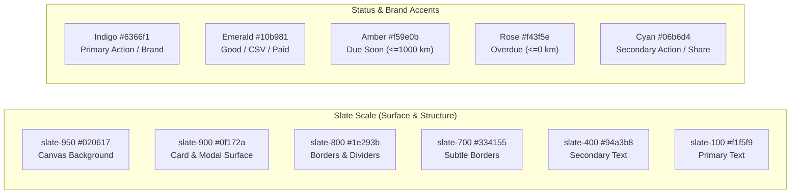

# DESIGN.md — AutoLog UI/UX Design System & Architecture

> **Document Scope**: Complete visual design specifications, color tokens, typography systems, component hierarchy, interaction patterns, and printable layout architecture for the **AutoLog** vehicle maintenance application.
> **Source of Truth**: [`index.html`](file:///e:/HTML/autolog/index.html) and [`instructions/UI-UX skill.md`](file:///e:/HTML/autolog/instructions/UI-UX%20skill.md).

---

## 1. Design Overview & Philosophy

AutoLog's design language is modeled after modern high-end automotive digital cockpits and performance telemetry dashboards. The visual design prioritizes:

- **Dark-Mode-First High Contrast**: A rich `slate-950` backdrop with subtle luminous ambient glows (`indigo-600` and `emerald-500` blurred orbs) that reduces eye strain in workshop and garage environments.
- **Information Density & Scannability**: Metric cards, monospaced odometer dials, and status indicators allow car owners and technicians to assess vehicle health in seconds.
- **Vector-First Micro-Visualizations**: High-performance inline SVG graphics (countdown progress bars and expense category donuts) with no heavy runtime dependencies.
- **Tactile Micro-Interactions**: Smooth hover elevations (`.motion-card`), fluid progress bar transitions (`.motion-bar`), and gentle entry animations (`.motion-enter`).
- **Dual Presentation Modes**: A vibrant interactive screen experience seamlessly paired with a clean, monochrome-optimized, high-contrast **A4 Printable Inspection Certificate** for physical vehicle handovers.

---

## 2. Visual Design System & Tokens

### 2.1 Color Palette



| Token Name | Hex Code | Utility Class | Usage Context |
|---|---|---|---|
| **Canvas Background** | `#020617` | `bg-slate-950` | Primary page background |
| **Surface Card** | `#0f172a` | `bg-slate-900` | Card containers, modal boxes |
| **Surface Elevated** | `#1e293b` | `bg-slate-800` | Secondary buttons, table header, chips |
| **Border Normal** | `#1e293b` | `border-slate-800` | Card borders, table dividers |
| **Border Active** | `#334155` | `border-slate-700` | Button outlines, input field borders |
| **Primary Brand** | `#4f46e5` / `#6366f1` | `bg-indigo-600` / `text-indigo-400` | Primary buttons, active tabs, odometer focus |
| **Status: Nominal** | `#10b981` / `#34d399` | `bg-emerald-500` / `text-emerald-400` | "Good" badge (>1,000 km), CSV actions, paid totals |
| **Status: Warning** | `#f59e0b` / `#fbbf24` | `bg-amber-500` / `text-amber-400` | "Due Soon" badge (≤1,000 km) |
| **Status: Critical** | `#f43f5e` / `#fb7185` | `bg-rose-500` / `text-rose-400` | "Overdue" badge (≤0 km), destructive reset actions |
| **Status: Pending** | `#475569` / `#94a3b8` | `bg-slate-700` / `text-slate-400` | "Unset" badge (requires baseline mileage) |
| **Accent Secondary** | `#06b6d4` / `#22d3ee` | `bg-cyan-500` / `text-cyan-400` | Share action, receipts & fees KPI |

### 2.2 Typography

Typography is loaded dynamically via Google Fonts with robust fallbacks:

```html
<link href="https://fonts.googleapis.com/css2?family=Inter:wght@400;500;600;700;800&family=JetBrains+Mono:wght@400;600;700&display=swap" rel="stylesheet">
```

- **Primary UI Font (`font-sans`)**: `Inter`, `system-ui`, `-apple-system`, `sans-serif`
  - Applied to headings, labels, button text, table descriptions, and modals.
  - Weights: `400` (Regular), `500` (Medium), `600` (SemiBold), `700` (Bold), `800` (ExtraBold).
- **Technical & Metric Font (`font-mono`)**: `JetBrains Mono`, `Fira Code`, `monospace`
  - Applied to odometer digits, license plates, currency amounts, dates, and JSON payloads.
  - Weights: `400` (Regular), `600` (SemiBold), `700` (Bold).

### 2.3 Motion & Keyframe Animations

```css
@keyframes fadeSlideUp {
  from { opacity: 0; transform: translateY(10px); }
  to { opacity: 1; transform: translateY(0); }
}
.motion-enter {
  animation: fadeSlideUp 0.3s cubic-bezier(0.16, 1, 0.3, 1) forwards;
}
.motion-bar {
  transition: width 0.55s cubic-bezier(0.22, 1, 0.36, 1), background-color 0.25s ease;
}
.motion-card {
  transition: transform 0.18s cubic-bezier(0.22, 1, 0.36, 1), border-color 0.18s ease;
}
.motion-card:hover {
  transform: translateY(-2px);
}
```

---

## 3. Screen Architecture & Layout Hierarchy

```
┌────────────────────────────────────────────────────────────────────────┐
│  STICKY TOP BAR                                                        │
│  [Vehicle Icon] Apex Centurion 2022  [KLM 4820] (Edit)│ [Profile v] [Hub] [A4] [Share] │
├────────────────────────────────────────────────────────────────────────┤
│  TOP METRICS ROW                                                       │
│  ┌───────────────────────┐ ┌─────────┬─────────┬─────────┬───────────┐ │
│  │ ODOMETER SIMULATOR    │ │ Tracked │ Next Due│ Total   │ Receipts  │ │
│  │ 45,000 km             │ │  4 / 10 │ 5,000 km│ $ 1,450 │ $ 1,200   │ │
│  │ [+1k] [+5k] [Reset]   │ │ Items   │ Oil     │ Logged  │ Paid      │ │
│  └───────────────────────┘ └─────────┴─────────┴─────────┴───────────┘ │
├────────────────────────────────────────────────────────────────────────┤
│  PERIODIC MAINTENANCE SCHEDULE TABLE                                   │
│  Filters: [ All ] [ Tracked ] [ Unset ] [ Due ]          [+ Add Item]  │
│  ────────────────────────────────────────────────────────────────────  │
│  Service Item   │ Interval │ Last Srv (km) │ Next Due │ Cost │ Status  │
│  Engine Oil     │ 8,000 km │ [42000] Save  │ 50,000   │ $ 65 │ 🟢 Good │
├────────────────────────────────────────────────────────────────────────┤
│  VECTOR SVG VISUALIZATIONS                                             │
│  ┌────────────────────────────────────┐ ┌────────────────────────────┐ │
│  │ REMAINING DISTANCE COUNTDOWN BARS  │ │ EXPENSE BREAKDOWN DONUT    │ │
│  │ Engine Oil [████████████] 5,000 km │ │     🍩 (Fluids, Brakes)    │ │
│  │ Gear Oil   [████████████] 22,000 km│ │ Total: $ 1,450             │ │
│  └────────────────────────────────────┘ └────────────────────────────┘ │
├────────────────────────────────────────────────────────────────────────┤
│  WORKSHOP MAINTENANCE & REPAIR HISTORY                                 │
│  [Search history...]                                     [+ Add Record]│
│  ────────────────────────────────────────────────────────────────────  │
│  2025-11-15 • 42,000 km • Engine Oil & Filter Service     • $ 65       │
│  2025-06-20 • 35,000 km • Front Brake Pads Replacement    • $ 140      │
├────────────────────────────────────────────────────────────────────────┤
│  VEHICLE SPECIFICATIONS FOOTER                                         │
│  Engine: 2.0L DOHC • Chassis: 1FA6P8... • Workshop: Metro Auto Care   │
└────────────────────────────────────────────────────────────────────────┘
```

---

## 4. Component Patterns & Specifications

### 4.1 Sticky Top Navigation Bar
- **Position**: `sticky top-0 z-30` with `backdrop-blur-xl bg-slate-950/85` and bottom border `border-slate-800/80`.
- **Vehicle Identifier**: Gradient icon pill (`bg-gradient-to-br from-indigo-500 to-cyan-500`), bold vehicle title, license plate badge with monospaced font, and inline `(Edit)` trigger button.
- **Action Toolbar**:
  - Profile dropdown (`#carProfileSelect`): Custom styled select input.
  - Unified Data Hub button (`#openDataHubBtn`): Emerald icon indicator.
  - A4 Report button (`#openA4ReportBtn`): Indigo filled primary button.
  - Share button (`#openShareModalBtn`): Cyan icon indicator.

### 4.2 Global Dashboard Filters Bar
- **Visual Container**: Rounded card (`bg-slate-900/90 border border-slate-800 rounded-2xl p-4 shadow-xl`) sitting directly beneath the sticky top navigation.
- **Filter Header & Status**: Indigo icon badge with uppercase title and live active filter summary string (`#filterSummaryText`), e.g. "Showing This Year (2026) • All Categories".
- **Date Period Presets**: Dropdown (`#filterDatePreset`) supporting `This Year (2026)`, `Last Year (2025)`, `Last 6 Months`, `All Time`, and `Custom Range...`.
- **Custom Range Controls**: Revealed conditionally when `Custom Range...` is chosen, featuring twin date pickers (`#filterDateStart` and `#filterDateEnd`).
- **Category Filter Dropdown**: Dynamically populated dropdown (`#filterCategorySelect`) listing all active maintenance categories.
- **Filter Reset Button**: One-click reset pill reverting the view to the current year and all categories.

### 4.2 Odometer Simulator
- **Visual Structure**: Multi-tone gradient card (`from-slate-900 via-slate-900 to-indigo-950/60`).
- **Live Status Indicator**: Pulsing emerald orb with uppercase tracking text.
- **Odometer Input**: Extra-large monospaced numerical input (`text-2xl sm:text-3xl font-bold`) accented with an absolute "km" unit label.
- **Quick Steppers**: Dedicated `+1k` and `+5k` buttons with active hover styles and a subtle `Reset` button.

### 4.3 KPI Summary Cards
- 4 grid cards displaying high-level vehicle health:
  1. **Tracked Items**: Count of items with established baseline vs. total schedule items.
  2. **Next Service**: Shortest remaining distance and service name.
  3. **Total Cost**: Cumulative sum of all maintenance logs in local currency.
  4. **Receipts & Fees**: Total cash paid out including workshop labor and diagnostic fees.

### 4.4 Periodic Schedule Table
- **Interactive Inline Editing**: The "Last Serviced At (km)" column contains inline numerical inputs. Modifying an input immediately displays a green "Save" button to commit the new baseline.
- **Filter Pills**: Multi-state pill filter (`All`, `Tracked`, `Unset`, `Due`) that dynamically recalculates without page reload.
- **Status Badges**:
  - `Good`: Rounded pill with emerald background, dot indicator, and remaining km.
  - `Due Soon`: Rounded pill with amber background and countdown warning.
  - `Overdue`: Rounded pill with rose background and exclamation badge.
  - `Unset`: Rounded pill with neutral slate background indicating missing baseline.

### 4.5 Vector SVG Visualizations
- **Horizontal Countdown Bars**:
  - Dynamic SVG viewBox scaled to container width.
  - Gradient-filled bars animated with `.motion-bar`.
  - Color transitions dynamically driven by remaining km thresholds.
- **Expense Donut Chart**:
  - SVG circle element with computed `stroke-dasharray` and `stroke-dashoffset`.
  - Centered aggregate total text.
  - Adjacent flex legend with category swatches, monetary values, and percentages.

### 4.6 Modals
All modals use fixed-position backdrop overlays (`fixed inset-0 z-50 bg-slate-950/80 backdrop-blur-sm`):
1. **Data Hub Modal**: Dual-tab interface (`CSV` tab in emerald, `JSON` tab in indigo). Includes raw JSON textarea with immediate syntax checking.
2. **Vehicle Specs Editor**: Comprehensive form for Make, Model, Year, Registration, Plate, Engine, Chassis, Transmission, and Workshop details.
3. **Schedule Item Modal**: Form to add or modify periodic maintenance items, intervals, and estimated costs.
4. **History Record Modal**: Form to log service dates, mileage, titles, categories, parts costs, paid amounts, payment methods, and notes.
5. **Share Modal**: Displays formatted vehicle health summary with native share and WhatsApp clipboard options.

---

## 5. Printable A4 Vehicle Condition Report

When **A4 Report** is clicked, a dedicated window opens containing a specialized HTML document designed specifically for A4 paper output:

- **Page Constraints**: Formatted with standard print styling:
  ```css
  @page { size: A4 portrait; margin: 12mm 15mm; }
  @media print {
    body { background: #fff !important; color: #0f172a !important; }
    .no-print { display: none !important; }
  }
  ```
- **Monochrome & High-Contrast Typography**: Uses black and dark slate text against pure white backgrounds to ensure crisp printing on all standard office laser and inkjet printers.
- **Letterhead & Identity**: Displays vehicle make, model, registration date, chassis number, engine number, license plate, and current odometer reading.
- **Schedule Audit Table**: Prints all periodic maintenance items with clean table borders and bold status markers (`GOOD`, `DUE SOON`, `OVERDUE`, `UNSET`).
- **Complete Workshop Ledger**: Lists all recorded maintenance history entries with dates, mileage, descriptions, categories, and costs.
- **Sign-off Block**: Contains dual verification signature lines for the Workshop Mechanic and the Vehicle Owner.

---

## 6. Accessibility & Responsive Breakpoints

### 6.1 Contrast & Accessibility
- **WCAG AA Compliance**: High-contrast text colors (`text-slate-100` and `text-white` on `bg-slate-900`) exceed the minimum 4.5:1 contrast ratio.
- **Form Controls**: All inputs have visible label tags or explicit `aria-label` attributes (e.g., `#carProfileSelect`).
- **Focus Rings**: Focusable elements feature high-visibility outline rings (`focus:outline-none focus:border-indigo-400`).

### 6.2 Responsive Breakpoints

| Breakpoint | Width | Layout Adjustments |
|---|---|---|
| **Mobile** | `< 640px` | Single-column layout. Top bar actions wrap compactly. KPI cards render 2x2. Table becomes horizontally scrollable (`overflow-x-auto`). |
| **Tablet (`sm`)** | `640px - 1023px` | KPI cards expand to 4 columns. Action buttons show icons and text labels. Modals size to `max-w-xl`. |
| **Desktop (`lg`)** | `1024px - 1279px` | 12-column layout. Odometer occupies 5 columns, KPI cards occupy 7 columns. Charts display side-by-side (7 cols countdown, 5 cols donut). |
| **Widescreen (`xl`)** | `≥ 1280px` | Centered maximum container (`max-w-7xl mx-auto`). Generous padding and maximum visual breathing room. |

---

## 7. Guidelines for Future Design Changes

1. **Retain Tailwind Utility Classes**: Do not introduce external CSS stylesheets or CSS-in-JS libraries. Leverage existing Tailwind utility classes and extend `tailwind.config` if new tokens are needed.
2. **Preserve Dark Cockpit Aesthetic**: Any new cards, forms, or controls must follow the `slate-950` / `slate-900` / `slate-800` visual hierarchy.
3. **Monospaced Technical Data**: Always use `font-mono` for numeric data, odometers, currencies, license plates, and timestamps.
4. **SVG Visualizations**: When adding new charts, implement them as lightweight native SVG DOM nodes rather than importing external graphics libraries.
5. **Print Stylesheet Integrity**: When adjusting table structures or data fields in the main app, verify that `generateA4Report()` is updated to reflect the new fields in the printable A4 certificate.
